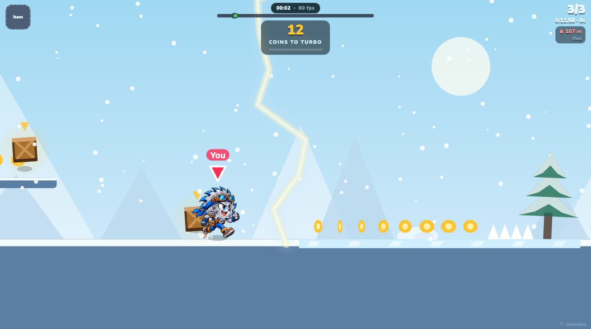
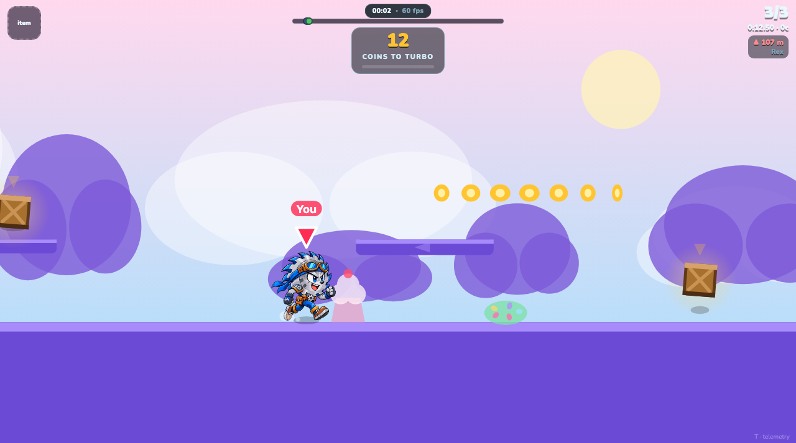
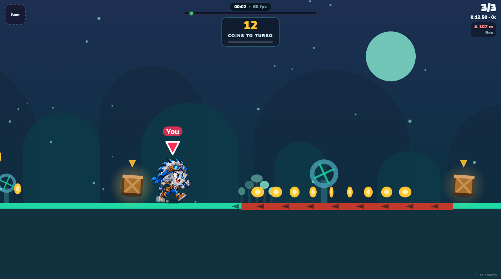
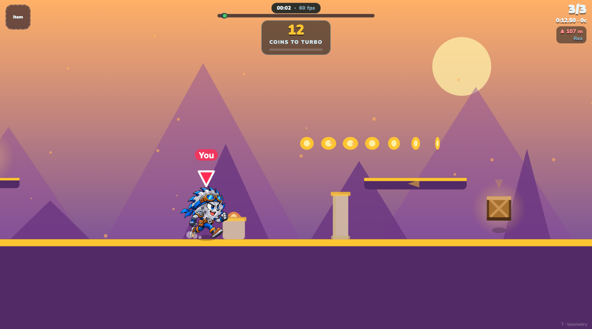
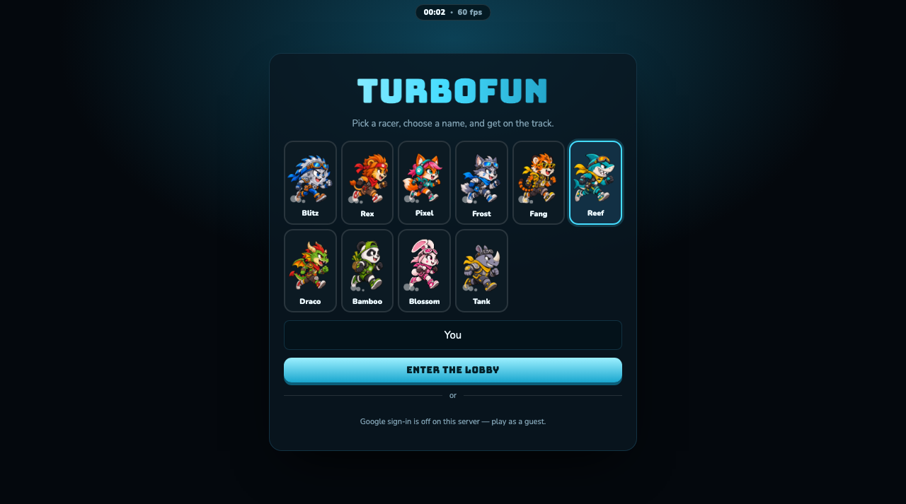

<div align="center">

# TurboFun

**A multiplayer running race in the browser.** Eight racers, one lane, a server that
has the final word. Jump the pits, kick the leader, collect coins for turbo, and try
to be the one who crosses first.



</div>

---

## What it is

A complete, server-authoritative multiplayer game, written in plain JavaScript with
one runtime dependency (`ws`). No build step, no framework, no bundler — open the
folder, run `node server/index.js`, and the game is at `http://localhost:8080`.

| | |
|---|---|
| **Netcode** | Client prediction, server reconciliation, entity interpolation, lag-compensated melee |
| **Server** | 60 Hz authoritative simulation, snapshots every 3rd tick |
| **Lobby** | Named rooms, passwords, ready gating, host controls, shared chat, quick match |
| **Bots** | Input-only — they play through the same pipe as humans, so they cannot cheat |
| **Tracks** | Four, 22-38 km, each with its own scenery, weather, terrain and hazards |
| **Size** | ~2,500 lines, one dependency |

## The tracks

| | |
|---|---|
|  | **Candy Rooftops** — 22,000 m, gentle. Lollipops, candy canes, cupcakes, donuts and jelly-bean bushes. Gumdrop **launch pads** throw you at the high coin arcs, **staircases** climb to a crate, and **sliding platforms** drift above the roofline. |
|  | **Neon Sewer** — 30,000 m, tight. Glowing fungus, bubbling sludge and dripping pipes. **Conveyors** run with you or against you, grates **blink** in and out, and pipes slide back and forth over the channel. |
|  | **Sky Temple** — 38,000 m, the long one. Braziers, banners and sandstone pillars. Temple **stairs** — some with a beam across the landing, so you climb and then duck — **lifts** to a high ledge, and stones that **crumble on a cycle**. |
|  | **Frostpeak** — 28,000 m, stormy. Snow-laden pines, blowing snow, **ice** you cannot steer on, and **lightning**: a bolt is announced with a flicker, and anyone caught under it is charred black as coal for a second and a half — and stumbles while they burn. |

## What is on the ground

Six kinds of terrain beyond jumping a pit, dealt out per map so no two tracks
feel alike, and never the same piece twice in a row:

| | |
|---|---|
| **Stairs** | Run at them and you climb. They lift you rather than stop you — a step never pins you in place. |
| **Sliding platforms** | A horizontal drift or a vertical lift. They carry whoever stands on them, and they are a pure function of the race clock, so every machine agrees where they are. |
| **Blinking platforms** | Solid, then gone, on a fixed cycle, with a fade that warns you. Always over solid ground: mistiming costs coins, not the race. |
| **Launch pads** | Twice the height of a jump. Candy only. |
| **Ice** | You keep whatever speed you had and change it slowly. Frostpeak only. |
| **Conveyors** | The floor moves — with you, or against you. Sewer only. |
## The racers

Ten characters, each with its own run style and its own signature attack.

<div align="center"></div>

A run style is a handful of numbers — bounce, lean, squash, sway, hover, spin — so
Blitz skims the ground, Draco hovers, and Tank pounds along. An attack is another
handful — reach, knockback, stun, pop — so Tank's charge throws people and Pixel's
jab is quick and cheap.

## Coins mean something

Coins are not a score. **Twelve coins buy two seconds of turbo**, which fires the
moment you collect the twelfth. The counter sits at the top of the screen, counting
down. That is the whole economy: the coin line through a jump arc is a real decision,
because the detour costs you metres now and pays them back later.

## Playing it

```bash
node server/index.js            # http://localhost:8080
node server/index.js --port 9000 --bots 3
```

Open the page, pick a racer, type a name, and either **Find match** (fills with bots
after ten seconds, with three seconds to cancel) or create a room and invite people
to the code.

**Keys** — `Space`/`W`/`↑` jump (twice for a double jump) · `S`/`↓` slide ·
`Shift` sprint (costs stamina) · `F` attack · `E` use item · `T` telemetry.
On a phone: a joystick and buttons appear instead.

## Deploying it

See [DEPLOY.md](DEPLOY.md). Short version: it is a single container, it holds state
in memory, and it wants one instance.

```bash
fly deploy        # ~$5/month on a shared-cpu-1x
```

The image has a health check at `/healthz`, per-IP rate limiting, and a graceful
shutdown that lets a race in progress finish.

## How it is put together

```
shared/     constants, physics, track generation   — identical on both sides
server/     room (the authority), lobby, bots, auth, rate limits
client/     net (prediction + reconciliation), render, main (views, HUD)
tools/      tests, screenshots, the sprite pipeline
```

The important rule: **`shared/` is the single source of truth for the simulation.**
The server runs it to decide what happened; the client runs the same code to guess
ahead, then corrects itself when the server disagrees. A track is a seed, not a map
file — both sides build the same 38,000 metres from one number.

## Tests

```bash
node tools/simtest.js     # physics: walls, stamina, lightning, every character
node tools/roomtest.js    # full bot races on every track, server-side
node tools/viewtest.js    # the real page in headless Chrome
node tools/soak.js        # four clients on simulated links, LAN to 280 ms / 8% loss
node tools/shots.js       # regenerates the screenshots in this file
```

Every test in there exists because the bug it checks for shipped at least once.
[DEVLOG.md](DEVLOG.md) says which.
